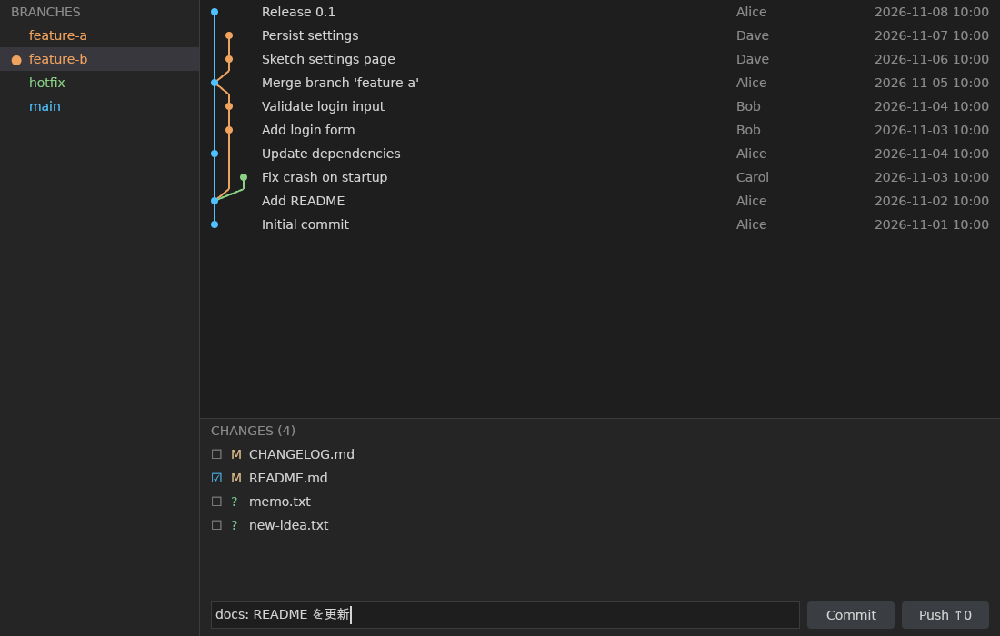

# kalapa

kalapa は、Rust と GPUI で作る Git の GUI クライアントです。SourceTree のように、履歴を見ながら、変更したファイルを選んでコミットし、push できます。git の操作には、インストール済みの `git` コマンドを使います。



## できること

今のバージョンでできることは次のとおりです。

- コミット履歴とブランチグラフを、ブランチごとに色分けして表示する。
- ブランチを切り替える。
- 変更したファイルを一覧し、クリックでステージとアンステージを切り替える。
- 1 行のコミットメッセージを打ってコミットする。日本語は IME で入力できる。
- 現在のブランチを push する。

ワークツリーの操作、差分の表示、fetch と pull は、まだありません。今後の予定は、[要件定義](docs/requirements.adoc)のロードマップにあります。

## 必要なもの

- Rust 1.85 以上。edition 2024 を使うためです。
- git。push の **Publish** には git 2.37 以上が要ります。
- Linux では、次の開発パッケージと Vulkan ドライバ。Ubuntu 24.04 では、次のコマンドで入ります。

  ```sh
  sudo apt-get install libxkbcommon-dev libxkbcommon-x11-dev libxcb1-dev libfreetype-dev libfontconfig-dev mesa-vulkan-drivers
  ```

macOS も対象ですが、まだ動作を確かめていません。

## ビルドして起動する

開きたいリポジトリのパスを渡して起動します。

```sh
cargo run -- /path/to/repository
```

パスを省くと、今いるディレクトリのリポジトリを開きます。リポジトリの中のサブディレクトリを渡しても開けます。

## 使い方

### ブランチを切り替える

左の **BRANCHES** で、ブランチ名をクリックします。現在のブランチには ● が付きます。

### コミットに入れるファイルを選ぶ

下の **CHANGES** に、変更したファイルが 1 行ずつ並びます。行をクリックすると、そのファイルをステージします。ステージ済みの行をもう一度クリックすると、アンステージします。チェックボックスの表示は次の 3 つです。

| 表示 | 意味 |
| --- | --- |
| ☑ | 変更がすべてステージ済み。クリックするとアンステージする。 |
| ⊟ | 変更の一部だけがステージ済み。クリックすると全部をステージする。 |
| ☐ | ステージしていない。クリックするとステージする。 |

ファイル名の左の文字は、変更の種類です。M は変更、A は追加、D は削除、T は種類の変更、? は git が追跡していないファイル、! は衝突中のファイルを表します。

選択の状態は、git のインデックスそのものです。ターミナルで `git add` したファイルも、kalapa のウィンドウに戻るとチェックが付きます。エディタで保存したファイルも、ウィンドウに戻ると一覧に出ます。

衝突中のファイルをクリックすると、`git add` が走り、git はそのファイルを解決済みとして扱います。ファイルに衝突マーカーが残っていても止めません。衝突を解消してからクリックしてください。

### コミットする

下の入力欄にメッセージを打ち、**Commit** を押します。コミットが成功すると、入力欄は空になります。

メッセージが空のときや、何もステージしていないときは、git が理由を返します。kalapa はその理由をウィンドウ上部の赤い帯に出し、打ったメッセージは残します。

### push する

**Commit** の右のボタンを押すと、現在のブランチを上流ブランチへ push します。ボタンの表示は次のとおりです。

| 表示 | 意味 |
| --- | --- |
| Publish | 上流ブランチがない。押すと、同じ名前でリモートに公開し、追跡を設定する。 |
| Push ↑N | 上流ブランチに送っていないコミットが N 個ある。 |
| Push ↑N ↓M | さらに、上流ブランチに取り込んでいないコミットが M 個ある。 |
| Pushing… | push の途中。押しても何もしない。 |

push が成功すると、表示は ↑0 に戻ります。↑ と ↓ の数は、最後に fetch または push をした時点のものです。

push はバックグラウンドで動くので、その間もウィンドウを操作できます。送るのは現在のブランチだけです。git の設定 `push.default` が何であっても、送り先は上流ブランチになります。

### git のエラーを読む

git の操作が失敗すると、ウィンドウ上部の赤い帯に git の理由が出ます。赤い帯は、次の操作が成功するまで残ります。

## 制限

今のバージョンには、次の制限があります。

- コミットメッセージは 1 行だけで、本文は書けません。
- 入力欄は横にスクロールしません。入力欄より長いメッセージは末尾が見えなくなりますが、コミットには全文が入ります。
- ssh のパスフレーズや host key の確認に、端末から答えることはできません。確認が要るときは push が失敗し、その理由が赤い帯に出ます。鍵は ssh-agent に登録しておいてください。
- HTTPS の認証は、git の credential helper が答えられるときだけ通ります。kalapa は端末で認証を尋ねません。

## 開発する

テストは次のコマンドで走ります。

```sh
cargo test
```

画面の動作は、Xvfb の上でアプリを起動して確かめます。`scripts/verify_on_xvfb.sh` は、試験用のリポジトリを作り、ブランチの切り替え、ステージ、コミット、push をクリックとキー入力で行い、git の状態で結果を確かめます。スクリーンショットは、渡したディレクトリに保存します。

```sh
scripts/verify_on_xvfb.sh /tmp/kalapa-verify
```

このスクリプトには、git、Xvfb、xdotool、ImageMagick、Vulkan ドライバが要ります。Vulkan ドライバは、ソフトウェアで描く lavapipe でもかまいません。スクリプトは X のディスプレイ `:99` を使います。

設計の考え方、名前の付け方、ファイルの分け方は、[AGENTS.md](AGENTS.md) にあります。
